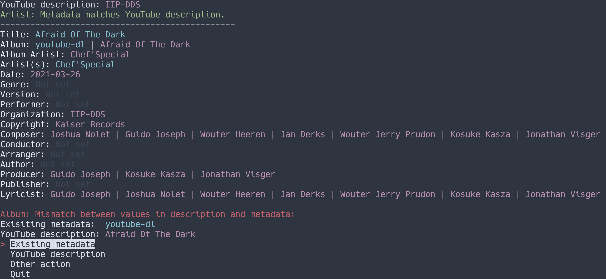
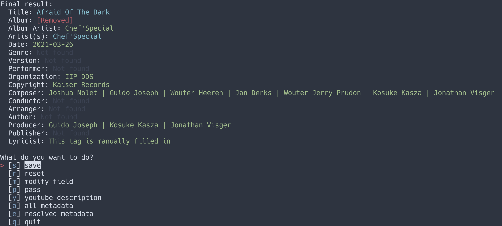

# Retag Opus

Say you have a music file in opus format, with a tag called
`description` that holds data about the music in the format of YouTube's
auto-generated descriptions. This script will help you parse that tag
and put the relevant data into the tags where it actually belongs, such
as `title`, `artist`, and `album`.

# Dependencies

Retag requires
[simple-term-menu](https://github.com/IngoMeyer441/simple-term-menu) to
be installed.

# Usage

Run the script like so:

```console
$ python3 retag --directory /path/to/directory/with/your/opus/files.opus
```

There is also a help (`-h`) flag:

```console
$ retag -h
usage: main.py [-h] [-d DIRECTORY] [-v] [-V]

options:
-h, --help            show this help message and exit
-s {bash,zsh,tcsh}, --print-completion {bash,zsh,tcsh}
                      print shell completion script
-g GROUPING, --grouping GROUPING
                      Sets the grouping tag to the given value, e.g. to put the songs in a mix of your own
-d DIRECTORY, --directory DIRECTORY
                      directory in which the files to be retagged are located
-i, --individual      Choose album level tags separately for each song, even for songs that are from the same album
-m, --musicbrainz, --no-musicbrainz
                      Look up songs on MusicBrainz, overriding the configuration file
-V, --version         show program's version number and exit
```

Retag will go through the opus file in the root of the directory you
provided and try to parse tag information from the YouTube description
if it is in the tags and from the original tags (e.g. adding another
artist if the title indicates a featured artist). It might look like
this:



Credits in descriptions are read as roles and a name, e.g. `Drums: Roger
Taylor`, and the roles are put in tags named as on MusicBrainz, e.g.
`performer:drums (drum set)`. Descriptions that YouTube generated from a
label's data list one person per line, sometimes with a category before the
roles, e.g. `Associated Performer, Drums: Roger Taylor`. Any role after
"Associated Performer" becomes a performer tag, e.g. `performer:theremin`.
Roles that have no tag, e.g. "Mastering Engineer", are left out.

An auto-generated description is found even when someone pasted it among their
own text, and it's read by its layout: the line after "Provided to YouTube by"
has the title and artists, the next one the album, and so on. The text around a
pasted copy is then left out. In a description written by whoever uploaded the
video, only credits with known roles and a few common sentences are read. A
pasted copy whose layout was changed, e.g. with all lines joined into one, is
read like such a description.

Purple text indicates that the tag comes from the YouTube description.
Blue indicates that the tag existed in the metadata since before. Yellow
indicates that the tag comes from interpreting one of the original tags,
and green indicates that the tag has been interpreted from one of the
new tags taken from the YouTube description.

As you go on adjusting tags, they turn green for indicating that you're
done adjusting them. In the end, some tags may stay blue, indicating
that you have selected the original tag or that no new data is
available. Here is an example of what it can look like:



As you can see, you can remove tags, which will make them print
"[Removed]" in red text. In the actual song metadata, they will just be
removed.

## Albums

Songs whose YouTube descriptions have the same album are considered to be from
the same album. For those songs, the album artist, date, genre and album are
only chosen once: when you save one of them, they are saved for all of them,
including songs that were skipped or passed earlier. Use `--individual` to
choose them for every song.

## Mixes

To put songs from different albums in a mix of your own, set the `grouping` tag
with `--grouping`, e.g. `--grouping "Road Trip"`. The album stays the one the
song is from.

## MusicBrainz

With the `--musicbrainz` flag, or `musicbrainz = true` in the configuration
file, songs are also looked up on [MusicBrainz](https://musicbrainz.org). Its
values are shown in orange and treated like the values from the other
sources. When sources disagree, an auto-generated YouTube description and the
tags parsed from it are preferred over MusicBrainz, since YouTube made the
description from the label's data. A description written by the uploader, and
the tags parsed from it, are less trusted than MusicBrainz. When a tag has
conflicting values, the menu starts on the value of the most preferred source.
Values that only differ in typography, like straight and curly apostrophes,
count as the same.

Besides title, artist, album, album artist and date, MusicBrainz gives track
and disc numbers, credits such as composer, lyricist, writer, producer and
performers, and MusicBrainz IDs, which are saved in the same tags as MusicBrainz
Picard uses. The IDs aren't shown, since they can't be checked by looking at them.
Instead, the line saying which track a song was found as shows its version and
release, so that a wrong match stands out. If the IDs are the only new tags for
a song, they're saved without asking. Track and disc numbers are used without a
message for each, but are shown in the result. If the song was found on
another album than the other sources say, e.g. because a single on YouTube is
only on an album on MusicBrainz, you are asked which album is right. Track and
disc numbers and release IDs are only used if it's the one found on
MusicBrainz.

Credits are named as on MusicBrainz, both those from MusicBrainz and those from
YouTube descriptions, so that they can be compared. Performers are saved in one
tag per role, named after the instrument or vocals, e.g.
`performer:drums (drum set)=Roger Taylor`. [Quod Libet](https://quodlibet.readthedocs.io)
uses the same tags, and Picard reads them.

Songs from the same album (see above) are looked up together, without asking
anything: they are matched by title and length to the tracks of a release with
the album's name, and the smallest and earliest release that has all of them
is used, so that e.g. the original edition is preferred over a deluxe edition.
Songs whose album isn't found this way are looked up one by one.

A song is looked up by its MusicBrainz ID if the file has one. Otherwise it is
searched for: by title and artist if they are in the YouTube description, and
otherwise by the words of its title, which is then usually a YouTube video
title like `KAUN TUJHE Full Video | M.S. DHONI -THE UNTOLD STORY |Amaal Mallik
Palak`. A result is used without asking if its title is among those words and
its length is within three seconds of the song's. Otherwise you choose among
the results, search for something else, or skip MusicBrainz for that song.

Looking up songs sends their titles, artists and albums to MusicBrainz. No
account is needed. MusicBrainz allows one request per second, so looking up a
song takes a few seconds.

## Configuration

You can configure tags that should be deleted. There are two ways you can
configure these. You can either say an exact tag name that should be deleted –
that is, the name of the tag itself, not its value. You can also specify a regex
that, if fully matching any value in a tag, will result in that tag being
deleted.

You specify this information in the Retag-Opus configuration file which is
`retag.toml` in your `XDG_CONFIG_HOME` directory, so usually
`~/.config/retag.toml`. Here is an example:

```toml
musicbrainz = true
tags_to_delete = [
  "language",
]
strings_to_delete_tags_based_on = [
  "delete_exactly_this",
  ".*delete_any_partial_match.*",
]
```

This will look up songs on MusicBrainz, delete the `language` tag, any tag containing the exact value
`delete_exactly_this` but not `delete_exactly_this_other_thing`, and also any
tag that matches the last regex, such as `test_delete_any_partial_match_test`.

## Glossary

- **Auto-generated description**: The description YouTube writes for
  music that labels deliver to it. It starts with "Provided to YouTube
  by" and ends with "Auto-generated by YouTube."
- **Tags parsed from original tags / Tags parsed from YouTube tags**:
  Values found by reading the file's existing tags, or the tags from the
  YouTube description, e.g. a featured artist or "Live" in a title.
- **Resolved metadata**: The tags that will be saved to the file.
- **Album level tags**: Album, album artist, date and genre, which are
  the same for all songs on an album.
- **Release**: One edition of an album on MusicBrainz, e.g. the original,
  a deluxe edition or a remaster. An album usually has several.

# Project status

The project is still under development. The most common tags can be
parsed but there are many more which will just be ignored. Work needs to
be done in usability.

Latest workflow status:


Latest version:


Acitivy since last release:


